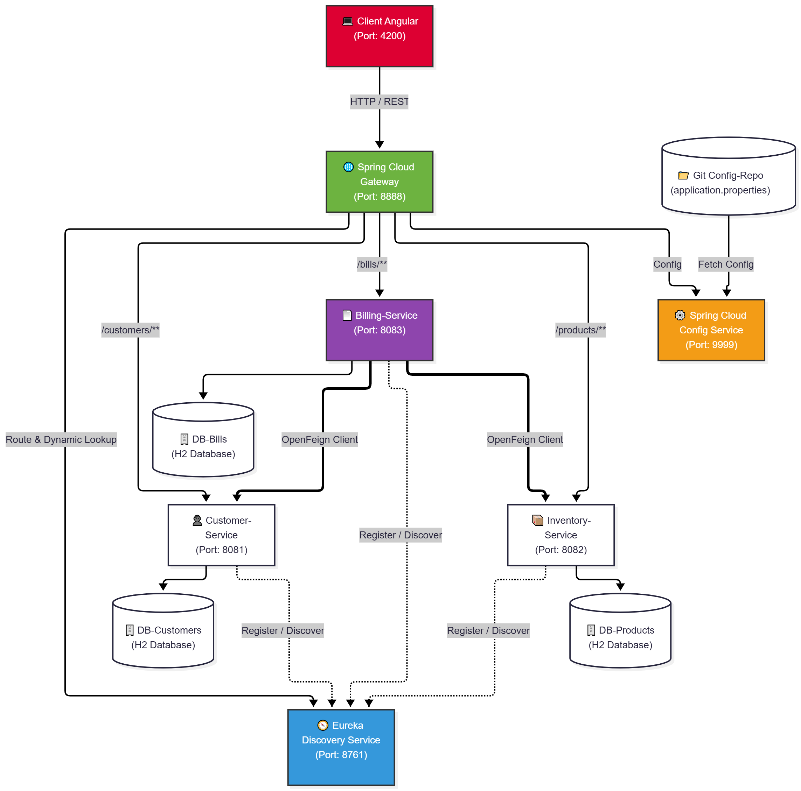

# Activité Pratique N°2 : Architecture Microservices avec Spring Cloud

## Présentation du Projet
Ce dépôt documente l'implémentation d'une application distribuée et tolérante aux pannes, conçue et développée par **Kawtar Khallouf**. Le système gère un modèle e-commerce complet articulé autour des clients, des produits et des factures enrichies.

---

## 🎯 Objectifs Pédagogiques et Réalisations
Le projet met en œuvre les briques fondamentales d'une architecture microservices moderne :
1. **`customer-service`** : Microservice de gestion des clients (JPA, H2, Spring Data REST).
2. **`inventory-service`** : Microservice de gestion du catalogue produits.
3. **`gateway-service`** : Point d'entrée unique avec routage dynamique et statique.
4. **`discovery-service`** : Annuaire et service de découverte Eureka.
5. **`billing-service`** : Microservice de facturation connectant les services via OpenFeign.
6. **`config-service`** : Serveur de configuration centralisée (Spring Cloud Config).
7. **Client Angular** : Interface utilisateur interactive et moderne.

---

## 🔗 Ressources et Références
- [Tutoriel Partie 1](https://www.youtube.com/watch?v=kOVHzN8I8e8)
- [Tutoriel Partie 2](https://www.youtube.com/watch?v=-iM3J_mgqlM)
- [Service de configuration](https://www.youtube.com/watch?v=-G2rcLMO1gQ)
- [Dépôt de référence initial](https://github.com/mohamedYoussfi/micro-services-app)

---

## 🏗️ Architecture Globale



### Table des Composants et Ports

| Composant           | Rôle Principal                                         |   Port |
| ------------------- | ------------------------------------------------------ | -----: |
| `discovery-service` | Annuaire Eureka (Enregistrement et Découverte)         | `8761` |
| `config-service`    | Serveur de configuration centralisée                   | `9999` |
| `gateway-service`   | Passerelle API, routage dynamique et gestion CORS      | `8888` |
| `customer-service`  | Gestion des entités clients                            | `8081` |
| `inventory-service` | Gestion des entités produits                           | `8082` |
| `billing-service`   | Gestion des factures et appels distants (OpenFeign)    | `8083` |
| `angular-client`    | Application Frontend SPA                               | `4200` |

---

## ⚙️ Logique de Fonctionnement

Le client Angular communique exclusivement avec la Gateway (`http://localhost:8888`), qui dispatche intelligemment les flux vers les microservices enregistrés dans Eureka :

| Route Publique  | Service Cible       |
| --------------- | ------------------- |
| `/customers/**` | `CUSTOMER-SERVICE`  |
| `/products/**`  | `INVENTORY-SERVICE` |
| `/bills/**`     | `BILLING-SERVICE`   |

Le service de facturation exploite **OpenFeign** pour interroger dynamiquement le service des clients et celui des inventaires lors de la consultation d'une facture. Les configurations distantes sont centralisées et synchronisées depuis le dépôt Git dédié (`config-ecom-appActivity`).

---

## 🚀 Guide de Démarrage et Exécution

### Prérequis techniques
- Java 17 (ou supérieur)
- Maven 3.8+ (ou utilisation du Maven Wrapper fourni)
- Node.js & npm (pour l'interface Angular)

### Ordre de lancement des microservices
Ouvrez un terminal distinct pour chaque service et exécutez la commande de démarrage :

```bash
# Sous Linux / macOS
./mvnw spring-boot:run

# Sous Windows (PowerShell)
.\mvnw.cmd spring-boot:run